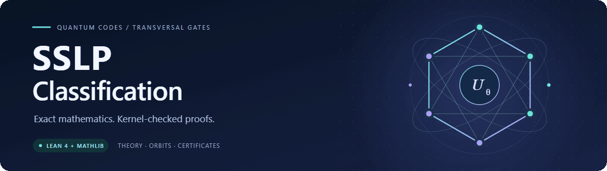

<p align="center">
  <picture>
    <source media="(prefers-reduced-motion: reduce)" srcset="docs/assets/banner.svg">
    
  </picture>
</p>

<h1 align="center">SSLP Classification</h1>

<p align="center">
  <strong>Finite Classification of Transversal Diagonal Gates Beyond Stabilizer Codes</strong>
</p>

<p align="center">
  <a href="lean-toolchain"></a>
  <a href="lake-manifest.json"></a>
  <a href="docs/review-guide.md#the-trust-boundary"></a>
  <a href="docs/status.md"></a>
</p>

<p align="center">
  <a href="paper/supplementary.pdf"><strong>Supplementary Materials (PDF)</strong></a> ·
  <a href="docs/README.md"><strong>Explore the proofs</strong></a> ·
  <a href="docs/explorer.md"><strong>Interactive explorer</strong></a> ·
  <a href="docs/reproduce.md"><strong>Reproduce</strong></a> ·
  <a href="docs/review-guide.md"><strong>Reviewer guide</strong></a> ·
  <a href="docs/status.md"><strong>Certification status</strong></a>
</p>

---

This repository brings together the general SSLP theory, six-qubit orbit
classification, exact certificate data, and Lean proofs supporting the main
paper and supplementary information. The canonical branch is **`main`**;
the complete project lives at the repository root.

## Start here

| Your goal | Best starting point |
| --- | --- |
| Read the Supplementary Materials | [SI PDF](paper/supplementary.pdf): 189 pages, manuscript snapshot `20261020` |
| Search by orbit or theorem | [Interactive proof explorer](docs/explorer.md): 72 curated guides and the complete source catalog |
| Understand the mathematics | [Selected proof entry points](docs/proof-index.md#selected-entry-points), then the complete [proof index](docs/proof-index.md) |
| Review a paper claim | [Reviewer guide](docs/review-guide.md) → [version-bound correspondence](docs/manuscript-correspondence.md) |
| Check the results yourself | [Setup and reproduction](docs/reproduce.md#setup), with focused and whole-project commands |
| Work on the formalization | [Architecture](docs/architecture.md), [module catalog](docs/proof-modules.md), and [contribution guide](CONTRIBUTING.md) |

## The proof landscape

<p align="center">
  <a href="docs/proof-map.md"></a>
</p>

[Foundations](docs/proof-map.md#foundations) ·
[General theory](docs/proof-map.md#general-theory) ·
[Orbits and certificates](docs/proof-map.md#orbits-and-finite-certificates) ·
[Final statements](docs/proof-map.md#final-physical-statements) ·
[Evidence](docs/proof-map.md#two-evidence-routes)

Want to search instead? Open the [interactive explorer](docs/explorer.md)
locally with `python tools/open_explorer.py`; it needs no server or extra packages.

## Proof highlights

**General theory.** Diagonal logical groups, SSLP normal forms, physical-order
bounds, and bridges from abstract statements to actual code and projector
semantics. Begin with [QECC](QECC/README.md) and the
[main-text entry points](docs/proof-index.md#main-text-theory).

**Six-qubit classification.** Orbit exclusions, exact constructions, logical
actions, and enumerator identities, with finite certificates transcribed into
Lean. Browse the [supplementary proof map](docs/proof-index.md#supplementary-material).

**Complete orbit-2/3 images.** Converse and interval attainment for actual
full-KL encoders, including exact distance three:
[orbit 2](MainTheory/Orbit2FullImage.lean) ·
[orbit 3](MainTheory/Orbit3FullImage.lean) ·
[exact rational data](docs/reproduce.md#finite-certificate-data).

## Verification at a glance

The table describes the **recorded `20261003` manuscript snapshot**, with
proof acceptance recorded on 2026-10-05. Later manuscript revisions, including
`20261006`, require a separate correspondence review.

| Layer | Recorded outcome | Evidence |
| --- | --- | --- |
| Whole Lean build | **16,227 active modules checked** | [Build and proof acceptance](artifacts/manuscript-certification-20261005/proof-acceptance-16227.json) |
| Transitive axiom audit | **9,375 selected roots**, standard Lean axioms only | [Axiom record](artifacts/manuscript-certification-20261005/axioms-9375.json) |
| SI mathematical correspondence | **1,622 assertions covered**; three scope remarks | [Correspondence guide](docs/manuscript-correspondence.md) |
| Frozen main-text correspondence | **Five author-held issues remain** | [Status and held issues](docs/status.md#current-manuscript-review) |
| Research questions | Orbit-1/4 full enumerator images remain open | [Mathematical scope](docs/status.md#completed-mathematical-proof-packages) |

**The combined manuscript certification remains incomplete.** Kernel checking
and manuscript correspondence are distinct checks; the
[reviewer guide](docs/review-guide.md) explains how to assess both.

## Quick start

Install Git, Python 3.12, and [Lean's toolchain manager](https://leanprover-community.github.io/get_started.html).
Use the pinned dependencies supplied by this repository:

```console
git clone --branch main https://github.com/xh-xihe/sslp-classification.git
cd sslp-classification
lake exe cache get
```

Start with orbit 2 and orbit 3, including their local dependencies:

```console
python tools/build_lean.py --module MainTheory.Orbit2FullImage --module MainTheory.Orbit3FullImage --module MainTheory.OrbitCertificationFinalAudit
lake env lean -j 1 -DwarningAsError=true MainTheory/OrbitCertificationFinalAudit.lean
```

<details>
<summary><strong>Check the whole active proof package</strong></summary>

```console
python tools/build_lean.py
python tools/verify.py --paper-version 20261003 --only sources generated audit-names axioms
python tools/repository_index.py --check
```

These proof checks do not require the private manuscripts. A fresh checkout
must compile the project's finite certificates; the Mathlib cache supplies
dependencies. The serial builder validates source and dependency stamps before
reusing compiled modules. See [reproduction](docs/reproduce.md) for expected
outputs, additional exact-data checks, and private-source review commands.

</details>

## Repository map

| Layer | Locations | What you will find |
| --- | --- | --- |
| Manuscript | [Supplementary Materials](paper/README.md) | SI PDF accompanying the `20261020` main manuscript |
| Foundations | [SS](SS) · [QECC](QECC/README.md) | Pauli and KL infrastructure; general diagonal-gate theory |
| Classification | [MainTheory](MainTheory) · [SixQubit](SixQubit) · [Orbit2](Orbit2) | Paper-facing theorems, orbit proofs, and generated certificates |
| Navigation | [Documentation](docs/README.md) · [Proof modules](docs/proof-modules.md) | Curated reading paths and the complete source inventory |
| Reproduction | [Tools](tools/README.md) · [Results](results/README.md) | Builders, exact generators, current status, and claim ledgers |
| Evidence | [Artifacts](artifacts) · [Review guide](docs/review-guide.md#follow-the-evidence) | Dated build, axiom, source-binding, and correspondence records |
| History | [Archive](archive/README.md) · [Historical tags](HISTORY.md) | Earlier stages and the preserved dyadic Bell ladder |

The [Supplementary Materials PDF](paper/supplementary.pdf) is available in `paper/`.
Manuscript TeX sources are excluded from this repository. The public
review records identify their versions, hashes, and claim locators.

Questions or discrepancies can be reported through
[GitHub issues](https://github.com/xh-xihe/sslp-classification/issues).
For changes, see [CONTRIBUTING.md](CONTRIBUTING.md).
