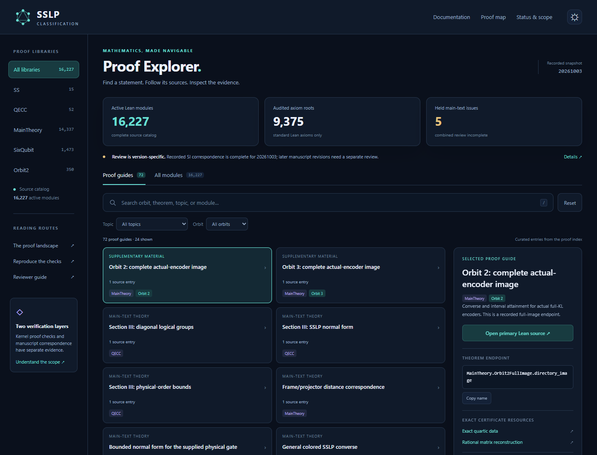

# Interactive proof explorer

[Home](../README.md) · [Documentation](README.md) · [Proof index](proof-index.md) · [Status](status.md)

Search the proof library by orbit, theorem topic, or module name. Select an entry
to follow its Lean sources and recorded acceptance evidence. Orbit 2 and orbit 3
also link directly to their exact rational certificates.



## Open the explorer

From a checkout of `main`, run:

```console
python tools/open_explorer.py
```

Or open [`docs/explorer/index.html`](explorer/index.html) directly in a browser.
The bundled file includes its data, styles, and scripts: it needs no server,
extra packages, or internet connection to search. Links to repository sources
open GitHub and use the repository's normal access permissions.

If browsing on GitHub, the HTML file link shows source. Download its **Raw** file
and open the saved `index.html` locally, or use the command above after cloning.

## Find a proof

**Proof guides** provides 72 curated entries from the paper-facing index.
**All modules** searches all 16,227 active Lean modules, with generated
certificate shards hidden initially. Enable **Include generated certificates**
to see the complete catalog.

Combine library, topic, and orbit filters. A search for `orbit 2` or `orbit2`
matches orbit 2 exactly, rather than orbit 20. Qualified module names such as
`MainTheory.Orbit3FullImage` also work. Press `/` to focus search; arrow keys switch
the browsing tabs. The page remembers the current filters in its URL fragment
and offers light and dark themes. On smaller screens, select a card to open its
details in a dialog.

The explorer preserves the recorded **20261003** review scope. That snapshot's
SI correspondence is complete; five held main-text issues prevent complete
combined manuscript certification. Orbit-1/4 full enumerator images remain open.
Later manuscripts need their own correspondence review. Catalog membership and
orbit tags provide navigation, rather than new mathematical coverage decisions.

## Maintain the explorer

The authoritative inputs are
[`results/proof-modules.json`](../results/proof-modules.json),
[`docs/proof-index.md`](proof-index.md), and
[`results/repository-status.json`](../results/repository-status.json).
The builder validates catalog targets, recorded orbit-2/3 endpoints, certificate
resources, and evidence paths. The bundle records SHA-256 hashes of the three
inputs after normalizing line endings. Private manuscripts are not read.

Regenerate after updating the inputs or the templates in
[`tools/proof_explorer`](../tools/proof_explorer):

```console
python tools/build_explorer.py
python tools/build_explorer.py --check
python -m unittest discover -s tools/tests -p test_proof_explorer.py -v
```

Documentation CI runs the consistency check and the standard-library regression
controls. An optional Playwright browser check exercises search, pagination,
filters, keyboard controls, URL restoration, mobile dialogs, and offline loading:

```console
python tools/tests/check_proof_explorer_browser.py --browser-channel msedge
```

With Playwright's Chromium installed, omit the channel option. Screenshots and
the report are written to `tmp/explorer-browser`; use `--output` to choose another
directory. Copy its `desktop-dark.png` to `docs/assets/explorer-preview.png` when
updating the preview. These navigation checks do not replace Lean verification
or manuscript correspondence review.
