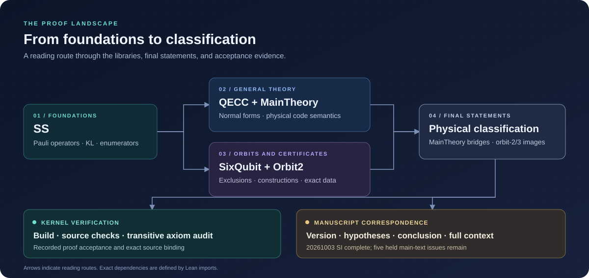

# The proof landscape

[Home](../README.md) · [Documentation](README.md) · [Detailed proof index](proof-index.md) · [Status](status.md)

The diagram is a reading map. The exact dependency graph is defined by Lean
imports. Use the links below to enter the relevant proof layer; the detailed
index retains the complete main/SI correspondence map.

To search this landscape by orbit, topic, or qualified module name, use the
[interactive proof explorer](explorer.md).

## Foundations

[SS](../SS.lean) supplies shared bitstrings, Pauli operators, KL conditions,
and enumerator identities. The [architecture guide](architecture.md) describes
the library boundaries.

## General theory

Begin with the [diagonal logical group theorem](../QECC/FirstTheorem.lean),
[SSLP normal form](../QECC/SecondTheorem.lean), and
[physical-order bounds](../QECC/ThirdTheorem.lean).

The [frame bridge](../MainTheory/QECCFrameBridge.lean),
[general SSLP converse](../MainTheory/PaperGeneralSSLPConverse.lean), and
[colored finite lift](../MainTheory/PaperColoredFiniteLift.lean) connect
abstract statements to physical code semantics. More entry points are in the
[main-text index](proof-index.md#main-text-theory).

## Orbits and finite certificates

[SixQubit](../SixQubit.lean) collects orbit proofs and constructions.
[Orbit2](../Orbit2/Complete.lean) retains the imported orbit-2 package.
The [supplementary index](proof-index.md#supplementary-material) identifies
the individual orbit, moment, encoder, and logical-action modules.

For exact rational inputs and reconstruction, follow the
[certificate data guide](reproduce.md#finite-certificate-data).
The [module catalog](proof-modules.md) groups generated Lean payloads by family.

## Final physical statements

| Topic | Final entry | Related check |
| --- | --- | --- |
| Orbit 2: complete actual-encoder image | [Orbit2FullImage](../MainTheory/Orbit2FullImage.lean) | [Focused kernel checks](reproduce.md#focused-orbit-checks) |
| Orbit 3: complete actual-encoder image | [Orbit3FullImage](../MainTheory/Orbit3FullImage.lean) | [Exact rational certificates](reproduce.md#finite-certificate-data) |
| Four split families: physical encoders and logical actions | [SplitFamilyTableCertification](../MainTheory/SplitFamilyTableCertification.lean) | [Full proof index](proof-index.md) |
| Seven-qubit example and minimum physical order | [SevenQubitMinimumOrder](../MainTheory/SevenQubitMinimumOrder.lean) | [Main-text proof map](proof-index.md#main-text-theory) |

## Two evidence routes

| Route | What it checks | Entry |
| --- | --- | --- |
| Kernel verification | Committed Lean statements, successful build, source gates, and selected transitive axiom footprints | [Whole proof package](reproduce.md#whole-proof-package) and [acceptance evidence](review-guide.md#follow-the-evidence) |
| Manuscript correspondence | The exact version, theorem hypotheses and conclusion, and surrounding manuscript context | [Correspondence guide](manuscript-correspondence.md) and [claim ledger](../results/paper-claims-20261003.json) |

The recorded review covers the `20261003` manuscript sources, including SI
edits through 2026-10-05. That SI review is complete. Five author-held main-text
issues prevent complete certification of the combined manuscript; orbit-1/4
full enumerator images remain open. Later manuscript versions require their
own correspondence review. See [current status](status.md) for the precise scope.
