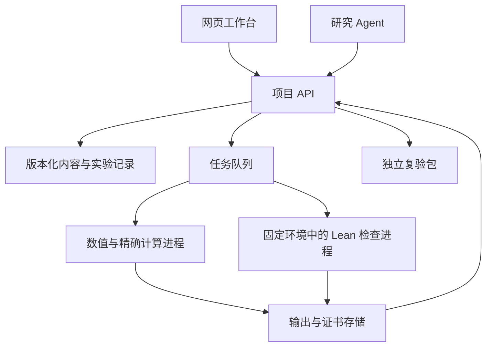

**SSLP Explorer：产品与验证体系实施规划**

规划日期：2026-09-24。目标文稿：`documents/20260924/main.tex`、`supplementary.tex` 及 `references.bib`。

本文件描述拟实施的产品，不表示所列功能已经开发或新版文稿已经通过全文认证。首版定位是浏览器中的交互式研究工作台，配套独立命令行复验工具；研究 Agent 使用同一组计算和验证接口。

实施进展另记于 [20260924 工作记录](sslp-explorer-progress-20260924.md)。已开始的首批交付是新版迁移清单、局部 Python API/CLI 和 class 36 的输入绑定证书；具体完成范围以工作记录与实际执行证据为准。

**1. 产品目标与首版范围**

用户应能完成一条完整路径：从论文命题进入具体数学对象，理解关键约束，修改一个输入，执行计算，检查证据，并在自己的机器上复验。

第一版聚焦六量子比特、一个逻辑量子比特、距离至少三的文稿案例。一般 n、K、d 的定义和结构定理可以阅读，但只有明确支持、测试并计量过的参数范围开放计算。后续扩展不得直接沿用六量子比特枚举的穷尽性结论。

提供三个入口，共享数据与验证服务：

| 入口 | 用户目标 | 核心交互 |
| --- | --- | --- |
| 阅读与学习 | 理解 SSLP 和代表案例 | 导读、公式与图形联动、逐步演示、参数预览 |
| 审稿与复验 | 确认具体陈述及其证据 | 假设核对、声明定位、依赖查看、局部重验、下载复验包 |
| 实验与研究 | 检查自定义对象、探索候选例子 | 结构化输入、计算任务、诊断、精确化、证书生成、实验比较 |

**2. 产品页面与内容**

| 页面 | 主要功能 | 第一版交付范围 |
| --- | --- | --- |
| 导览 | 解释物理门、逻辑作用、余数纤维、矩约束与完整 KL 的联系 | 一条可完成的入门路线，链接术语与原文 |
| 论文阅读器 | 公式、定理、表格与证明对象互相定位 | main 与 supplementary 导航、稳定声明链接、证据抽屉 |
| 分类地图 | 按 q、m、纤维大小、LP 维数和实现状态筛选 | 66 类数据；15 个可实现类；各类实现与枚举集合状态分开显示 |
| 案例工作台 | 态、门、电路、纤维、矩阵、KL 残差、枚举多项式联动 | class 36、class 7、一个相位矛盾排除案例；电路分阶段交付见 4A |
| 验证中心 | 执行、取消、查看和复现实验 | 预存证据、当前局部重验、可下载包；全文重建单列为重任务 |
| 研究实验室 | 自定义角度、支持与振幅，保存分支 | 第一版提供受支持输入的手动检查，后续增加批量搜索 |
| 研究助手 | 解释当前对象、选择工具、安排实验 | 先开放引用与确定性工具调用，再开放有预算的搜索与证明尝试 |

66 类是对称数据类，不是 66 个量子码，也不是 66 个局部酉等价类。15 个可实现类与 11 个已确定的重量枚举集合也不能合并为一个“已完成”字段。

**3. 三个首发完整案例**

class 36 展示阶五构造、门的物理与逻辑作用、KL 检查和刚性结论。具体构造的验证与整个类的唯一性证明使用不同证据卡。

class 7 展示连续参数族、振幅与概率、重量枚举向量的变化，以及参数边界。滑块提供近似预览；用户选择精确值后执行对应实例的验证。若某项依靠已验证的全参数定理，必须显示该定理的假设与实例化关系。

排除案例从现有相位循环证明中选择，初选 class 61。逐步显示纤维、允许的翻转、相位边、非零性条件和最终矛盾。选择最终案例前先确认其与 20260924 正文的路线对应及独立验证成本。

首个案例先做 class 36，优先打通完整链路；三个案例通过后再批量扩充案例模板。

**4. 可视化规范**

- 基态使用带位串标签的网格或可选择坐标的投影；不能把六维超立方体投影误当成完整三维几何。
- 概率使用柱状图，复振幅同时显示模长和相位；不能仅显示概率而隐藏相干性。
- 选中一个 Pauli 算符时，高亮对应支持点、翻转关联及方程项。
- 矩多面体采用真实的二维/三维截面或标明方式的投影；高维情况配合约束表和活跃面信息。
- 相位图中的每条边链接到产生该关系的 KL 方程和所需非零性条件。
- 重量枚举图标明参数域、已证明的集合范围、构造给出的包含关系和猜想范围。
- 每个图形提供可复制的精确数据与文本解释，颜色之外同时使用标签。
- 面向论文读者提供英文内容，教学解释支持中英切换；数学对象和状态数据共用。

**4A. 电路工作台：编码、横向门与可复验实验**

依据 2026-09-24 的追加建议，把电路作为案例工作台的核心视图，与 SSLP 的支持、振幅、相位和 KL 方程共用数据。下列内容是新增实施计划，尚未实现；它也增加了现有码空间证明之外的电路语义证明义务。

参考材料分别提供两种方法：VarQEC（Quantum 6, 828，2022，Sec. 4 与 Fig. 2）用 KL 代价函数寻找码及其编码电路；用户提供的《Transversal Gates in Nonadditive Quantum Codes》（2025-08-20 版本，Appendix F，第 26 页）针对已给定的逻辑基态拟合编码电路。前者适合研究搜索，后者适合把现有 SSLP 构造接到电路实现。

Appendix F 的模板交替应用每个比特上的 U3 与环形相邻比特之间的 controlled-U3，每轮合计 6n 个参数。Table VII 使用六比特 L=10、七比特 L=20，报告损失小于 10^-12。该附录给出模板与优化结果，没有列出这些实验的完整角度数组；重现具体实例需要取得对应参数或重新优化。L 表示模板重复次数，实际门深度还取决于门的执行顺序、并行调度和分解。

建议提供以下联动操作：

| 视图 | 用户操作 | 数学与证据连接 |
| --- | --- | --- |
| 编码过程 | 输入任意逻辑叠加态，展开编码块，按门或层播放 | 每一步显示振幅、相位与支持；区分已知等距映射、门级实现及其验证状态 |
| 横向门 | 查看每条物理线上的对角门，修改允许的门参数 | 基态累计相位连接子集和与余数纤维；同时显示码空间保持性、逻辑作用与泄漏 |
| KL 实验 | 选择一个错误或错误对，在电路中插入并查看对应矩阵元 | 方程、Pauli 支持、测量电路和精确检查结果互相定位 |
| 编码电路搜索 | 选择目标构造、模板、层数和预算，比较优化过程 | 单独记录拟合误差、KL 残差、横向门残差及电路资源；保留种子与实际参数 |

六比特实例令 J|ψ⟩=|ψ⟩⊗|0⟩^⊗5，V=[|0_L⟩,|1_L⟩]。定义电路门序列的矩阵语义 ⟦C⟧ 后，认证链路分别要求：

- V†V=I，确认逻辑态规范正交。
- ⟦C_enc⟧J=V，确认电路对任意逻辑叠加态实现指定编码；若允许相位或逻辑基变换，必须明确写出对应等式。
- U_phys V=V U_L，确认给定物理横向门在码空间中的逻辑作用；不能仅检查压缩矩阵而遗漏泄漏。
- V†E_a†E_bV=λ_ab I，确认指定错误集合的完整 KL 条件。六比特距离至少三的现有检查也可通过完整的重量不超过二的 Pauli 检测条件连接。

这些等式需要通过门嵌入、张量位序、顺序复合和既有码空间声明的桥接证明接入 Lean。网页渲染、浮点模拟、一般电路优化器及导出器自身不因此自动进入可信核心。优化后的电路需要新的等价性或误差证据。

Appendix F 的损失只约束两个目标态各自的保真度。根据该损失的形式，即使损失精确为零，也可能得到 ⟦C_enc⟧J=VD，其中 D=diag(exp(iφ0),exp(iφ1))。这仍编码同一码空间，但指定逻辑基中的相对相位发生变化。产品须记录 D，或在输入端补偿 D†；对一般逻辑门，电路坐标中的作用变为 D†U_LD。除检查两个基态，还应以 |+⟩、|+i⟩ 等叠加态暴露相位约定错误；有限模拟样例不替代全称等式证明。

电路状态分别显示“模板/抽象编码块”“数值拟合实现”“精确代数检查”“Lean 已检查的精确实现”或“Lean 已检查的误差上界”。接近零的浮点损失不能获得精确编码状态，近似电路上的严格误差界也不能称为精确等式。若精确重建失败，保留可重现实验及近似状态。

首版提供理想模拟和可复验电路描述。无噪声的编码—横向门—逆编码演示使用 C_enc†，不将逆编码自动称为噪声下的纠错恢复；恢复映射和容错编码若加入，需要独立设计和认证。横向门的局域性也不自动证明整个编码电路容错。

电路约定必须固定 U3 的完整矩阵及相位、受控门定义、控制/目标编号、环上门的先后顺序。特别是一个门的全局相位在加控制后可能成为相对相位，不可随意丢弃。连接旧论文的 C10 与新版的阶五逻辑作用时，先核对是否商去全局相位、物理代表、逻辑基及局部酉/置换关系，再建立实例映射。

实施顺序：P1 为 class 36 增加精确横向门层、输入叠加态和抽象编码映射的联动；P2 接入一个实际编码电路、模拟回放及独立的实现证据，允许明确标识的近似版本；P3 增加 Appendix F 模板拟合、class 7 参数族的电路比较与深度/双比特门数优化；P4 让 Agent 调用同一套有预算的搜索和检查工具。若 P2 暂无精确门级证明，应明确保留该缺口，码空间已有证明不能替代它。

**5. 证据与认证模型**

每个结果分别记录以下维度，界面摘要可以简洁，详情必须可查：

| 维度 | 需要区分的情况 |
| --- | --- |
| 数学状态 | 定理、构造、猜想、开放问题、反例、待核对陈述 |
| 文稿对应 | 已人工审阅对应、待审阅、假设/结论不匹配、版本变化后失效 |
| 证明路线 | 对应正文步骤、使用替代路线证明同一结论、仅覆盖部分步骤 |
| 执行证据 | 数值诊断、精确代数检查、Lean 核检查、失败、超时、尚未执行 |
| 验证范围 | 一个输入、一个命题、一个参数族、一个有限范围、完整发布版本 |
| 版本与重用 | 文稿哈希、代码提交、工具链与依赖、输入哈希、证书哈希、缓存来源 |

“数值求解未找到解”不能转成不存在性定理。“候选例子通过 KL”不能转成分类穷尽性。“Lean 证明了相同结论”不能自动覆盖正文中另一条证明路线的全部步骤。

既有可信基线继续执行：审核声明与假设、检查依赖闭包，只接受项目指定的标准公理集合，拒绝占位证明及绕过内核的认证路径。公理审计、源码对应和构建成功分别保存结果。

网页显示和 Agent 回答不属于数学可信核心。新的用户输入须实例化经过审核的定理模板，或生成并检查真正对应输入的新证明对象。来自 Python 的计算或证书只有经过对应检查后才能获得相应状态。

**6. 20260924 文稿迁移与形式化工作线**

1. 固定新版文稿及当前仓库快照，记录哈希和工具链。
2. 提取定理、定义、公式、表格及需要审阅的正文断言；为对象建立稳定标识，行号只作定位信息。
3. 与 20260908 清单比较文本、上下文、假设、结论和编号。移动或相似文本只能产生对应候选，不能自动获得已认证状态。
4. 重新核对既有勘误是否已经在新版修复、仍然适用或已经不适用；正文修改遵循作者已经给出的决定。
5. 分别列出命题覆盖和正文步骤覆盖，补齐所需证明、桥接声明及依赖。
6. 让验证入口显式接收文稿版本和发布清单，移除对某个日期清单的隐式绑定。
7. 对发布快照运行源码检查、构建、公理审计、对应核对、证书负向测试和完整性检查。

论文明确标为猜想的数学内容保留其状态，可以形式化其陈述和相关已知事实；产品不能以“完成发布”为由宣称已证明猜想。若全文严格验收仍有缺口，可以发布注明范围的产品版本，但不得宣称新版全文 fully kernel certified。

**7. 数据模型与版本规则**

核心对象为 PaperVersion、Claim、Orbit、CodeInstance、Circuit、Experiment、VerificationJob、EvidenceBundle 和 ReleaseManifest。

Claim 连接文稿位置、精确陈述、假设、Lean 声明、证明路线和证据。Orbit 连接论文编号、内部键、代表与等价关系。CodeInstance 记录具体态与门，不能与 Orbit 混用。Experiment 记录输入、父实验、搜索范围、随机种子与预算。VerificationJob 记录实际执行过程；EvidenceBundle 是可移植的验证材料；ReleaseManifest 固定整套公开内容的版本。

Circuit 记录关联的 CodeInstance、输入嵌入、逻辑基与相位约定、有序门列表、参数精度、门集、连接拓扑及来源；分别保存编码映射证明、门分解等价性、近似误差和实际重验记录。同一码可以有多个电路实现，不能沿用码空间的认证状态作为每个电路的认证状态。渲染、模拟与导出使用同一版本化电路中间表示；导出格式的往返一致性单独检查。

输入协议显式规定：位序、量子比特编号、Pauli 约定、角度单位、逻辑基、规范化规则、q 与 m 的含义。精确数使用带类型的表示，逐步支持有理数、平方根以及所需分圆数；近似浮点数据另存精度信息。

同一逻辑作用的有限阶物理代表、原始物理门与代表阶的最小性需要分别记录。只有证据覆盖时才显示“最小物理阶”。

旧实验绑定旧快照，新发布不能静默覆盖旧证据。分享链接应固定对象与版本，并允许显式切换到最新版。

**8. 系统架构**

前端采用 TypeScript 组件式界面，桌面浏览器优先，同时保证移动端可阅读。论文阅读、图形和计算面板共用结构化对象。

Python 服务封装经过确认的计算函数，可采用 FastAPI 作为接口层。重计算交给独立工作进程和任务队列，API 只接收任务、报告状态和返回材料。首版使用单台计算主机的有限并发，是否拆成多台服务由性能实测决定。

Lean 工作进程使用固定工具链、依赖与发布快照。已构建的基础依赖可以复用，但需记录其来源与校验状态；一次局部实例验证不能伪装成整库重建。

任务设时间、内存与并发限额，支持取消；隔离用户输入、生成文件和项目源码。超时是执行状态，不能代表数学否定结果。

内容与已发布证据可静态读取，计算主机暂不可用时仍能阅读并下载已有复验包。实验元数据和较大证明材料分开保存，避免每次请求加载全部证明库。

可参考 lean4web 的网页编辑与服务端 Lean 交互；其定位偏向小型片段，完整项目验证仍由本项目服务管理。ProofWidgets4 可用于适合嵌入 Lean 的数学对象与目标状态展示，不要求所有图形都放进 Lean 编辑器。

**8A. 模型后端：默认开放模型，可选闭源模型（2026-09-25 决定）**

按作者要求，研究助手优先使用开源或开放权重模型，同时保留可选闭源模型。
这是模型接入设计，尚未部署模型服务或接入在线 Agent；当前网页的确定性计算
与已有证书下载无需大语言模型。具体模型与规模在部署资源和代表任务评估后确定。

模型层与计算、Lean 验证层独立。模型负责解释、提出候选、生成工具参数及证明
草稿；经过参数检查的工具执行计算，固定环境中的 Lean 检查实际证明对象。
模型更换只影响建议、成功率、速度和成本，不改变定理假设、允许公理和认证规则。

接入契约与默认行为：

| 对象 | 约定 |
| --- | --- |
| 模型配置 | `provider_id`、`adapter`、`model_id`、`model_revision`（能取得时）、`base_url`、服务端密钥引用及能力声明；不在网页中保存密钥 |
| 默认路由 | 明确选定的开放模型；支持本地开发服务、自托管计算服务器或选定的托管端点，部署地点与模型开放性分别记录 |
| 闭源选项 | 管理者配置后，用户可为会话或单次任务显式选择；失败时不静默改用另一提供方 |
| 统一请求 | 版本化消息、声明与证据引用、结构化工具定义、输出预算、超时；各适配器转换供应商协议 |
| 能力检查 | 分别检查工具调用、结构化输出、流式返回与上下文限制；API 兼容不代表模型具备相同能力 |
| 统一返回 | 文本、待校验工具调用、实际模型与端点标识、结束原因、可取得的用量与延迟；不含模型可设置的认证状态 |
| 任务记录 | 固定提示模板版本、上下文/输入哈希、模型配置、工具参数与实际结果；记录用于追溯，不承诺采样逐字可重现 |

第一种适配器以常见的 Chat Completions 兼容接口为起点，可接 Ollama 本地服务
或 vLLM 服务；需要不同原生协议的闭源提供方使用独立适配器，不把所有供应商
能力强行压进最低公共接口。工具参数始终通过项目自身 schema 检查，只有注册工具
可以执行；模型输出的“证明成功”文字不能创建或修改 EvidenceBundle 的认证结果。

开放模型不可用时，手动计算和已发布证据仍可使用；助手说明不可用原因。提供方
切换不重用另一模型尚未完成的工具调用，也不覆盖先前实验与证据。网页与模型服务
通过后台连接，远程网页不能把服务器的 `localhost` 当作访问者机器上的模型服务。

模型评估采用同一组项目任务：文稿带引用解释、实验参数转换、正确选择工具、
读取真实失败见证、提出并修复 Lean 草稿。分别记录任务成功率、错误认证表述、
延迟、显存/内存和实际费用。开放模型的自托管仍有硬件和运维成本，不预设其总成本
一定低于托管调用，也不预设某个闭源模型在所有任务上更强。

实施顺序：先在 Lean 任务接口旁明确工具 schema 和 Provider 契约，再完成默认
开放模型适配及离线模拟测试，接入一个真实端点进行上述评估，最后增加可选闭源
适配器和界面选择。模型权重下载、GPU 部署、付费端点与外发文稿范围在具体服务
选定时配置；本次规划更新没有执行这些操作。

接口依据：[Ollama 兼容接口](https://docs.ollama.com/api/openai-compatibility)、
[vLLM 在线服务](https://docs.vllm.ai/en/latest/serving/online_serving/)。
文档核对日期：2026-09-25；实现时仍须针对实际服务和模型验证支持的能力。

**9. 计算工具产品化**

先建立经过测试的工具注册表，再接 App 和 Agent。首批接口包括：获取声明/类/证据、构造余数纤维、建立矩约束、求解并检查精确 LP 证书、计算完整 KL 条件、计算门作用与枚举数据、实例化已知构造、提交 Lean 核验、查询/取消任务、导出证据包。

工具必须返回结构化结果，包括支持范围、数学对象、诊断、证据类型和错误。不能将历史脚本的所有打印输出直接当作产品接口，也不能开放任意脚本路径执行。

电路接口分批加入：获取指定码的电路描述、逐步模拟、计算编码/横向作用残差、拟合目标编码器、提交电路语义核验和导出电路材料。先实现受支持门集和六比特实例，模板拟合及资源优化在 P3 开放。

当前仓库保留有历史算法和修复说明。适配时以已修复的完整 KL 实现和独立证书检查为基础，针对位序、dressings、补纤维对应、零振幅边界等已知错误类别保留回归测试。

数值搜索负责快速提出候选；精确重建负责将适用的候选变成精确对象；Lean 负责对应证明检查。三个阶段分别报告成功、失败或不支持，不能假定每个数值候选都可以自动精确化。

**10. Agent 的三个能力阶段**

第一阶段是可追溯的讲解：读取当前文稿、声明与图形状态，用引用回答问题，并能跳转到证据。

第二阶段是实验操作：把自然语言转换为显示给用户的参数和实验配置，通过工具修改参数、比较实例、运行验证和导出材料。所有动作与结果记入实验记录。

第三阶段是有预算的研究：选择支持类型、生成候选、调用数值搜索、尝试精确化、生成证明草稿、调用 Lean 修复循环，最后报告发现、未解决条件和耗用预算。

同一组工具先供手动界面调用，再接入 Agent；Agent 不直接决定认证徽标，也不自动把用户实验加入正式发布内容。首版不以无边界自主研究为交付目标。

研究目标分级：验证一个给定对象、构造新参数实例、提出候选新家族、证明家族性质、证明与已知对象不等价、证明分类穷尽性。这些是不同任务，不能把前一级成功宣称为后一级成功。

**11. 复验与发布**

每个证据包包括：精确输入、待验证的声明及假设、相关源文件、依赖锁定信息、工具链版本、复验命令、预期结果、源码/输入/证书哈希和验证范围说明。

提供局部验证包与完整发布包。局部包可复用明示的已构建依赖，完整包支持从固定源码重建项目。独立机器复验是发布验收项目，而不是只检查生成服务器上的绿色标记。

发布形态依次为：本地可运行版本、通过链接访问的审稿演示版、公开研究版。公开阅读和既有证据下载尽量免登录；长时计算按需要增加身份、配额和实验保存。用户实验默认不进入公开目录。

正式版本保留固定文稿与代码快照、变更记录和证据索引。论文、程序与依赖的再分发方式按实际授权确定，不在未核对前自行改变许可。

**12. 实施顺序与验收关卡**

| 阶段 | 主要交付 | 进入下一阶段的条件 |
| --- | --- | --- |
| P0 基线 | 新版差异清单、证据模型、工具接口草案、代表任务性能测量 | 能说明新版每类结论的来源与当前验证范围；测出冷/热构建和单实例成本 |
| P1 首条完整流程 | class 36 从阅读、输入、计算到核验与导出；横向门层与抽象编码映射联动 | 在独立环境复验成功；故意损坏输入或证明时能拒绝；编码块状态准确 |
| P2 审稿版 | 66 类地图、论文导航、三个交互案例、一个实际编码电路、证据详情与分享链接 | 数据与文稿快照一致；用户能完成理解与复验流程；电路近似/精确及核验状态准确；错误与超时状态正确 |
| P3 研究者版 | 自定义输入、更多构造族、实验历史、批量检查与精确化、编码电路拟合与比较 | 在声明的输入范围内结果可重现；边界、异常和负例测试通过 |
| P4 Agent 版 | 有引用的解释、工具操作、实验比较、受限搜索与证明尝试 | 回答可追溯；工具参数可核对；失败不会产生错误认证状态 |
| P5 稳定发布 | 完整发布清单、独立重建、运维与资源配额、使用文档 | 发布版本各项检查通过；已知未完成项及适用范围完整披露 |
| P6 扩展 | 更大参数、其他码族与更强研究自动化 | 对每一扩展重新证明/检查适用性，并完成复杂度与资源评估 |

形式化工作线贯穿 P0–P5，与界面开发同时推进。全部正文步骤的严格覆盖可能比首版产品更长；若包含未解决的数学陈述，需单独立项，不能用界面完成率掩盖。

**13. 测试与性能验收**

- 内容一致性：定理假设、类编号与内部键、表格数值、公式参数域、版本链接。
- 数学正确性：已知正例、已知排除例、零振幅与边界、错误位序、遗漏/变号 KL 条件、错误 LP 证书。
- 电路正确性：逻辑叠加态的相对相位、受控门相位、门执行顺序、输入嵌入、码空间泄漏、错误导出、近似参数冒充精确值、优化前后语义变化；数值与证明检查分别记录。
- 认证正确性：禁止不合格证明路径、检查声明依赖、公理集合及缓存来源；破坏证书或源码应使核验失效。
- 交互正确性：拖动参数、切换对象、提交/取消任务、比较实验、刷新后恢复和下载复验。
- Agent 评估：解释出处准确、参数转换准确、正确选择工具、如实报告未知/超时，不能把单点检查说成全称定理。
- 性能测量：页面加载、参数预览、纤维/KL 建模、精确 LP、单实例 Lean、全文重建、峰值内存及每类任务成本。

目标是静态阅读和参数预览快速响应；核验根据实测耗时显示任务进度。性能数字和并发额度在 P0 测量后锁定，不承诺任意研究计算即时完成。

**14. 工作组织与排期方法**

工作按四类责任拆分：数学与形式化对应、计算与验证服务、交互与内容、集成与独立验收。它们可以由同一开发者分阶段承担，也可以协作；数学语义变化仍需作者审阅。

先完成 P0 的小样本基准和 class 36 流程，再按实测任务规模估算里程碑日期。排期分别列产品工程、已有证明适配、未知证明义务三部分，避免将尚未解决的数学工作承诺为固定工期。

运行成本主要记录 Lean CPU/内存、长时搜索、Agent 调用和证据存储。先复用确定的发布材料与输入哈希对应结果，对确实要求重新执行的任务另行计量。当前 Lean 验证路径按 CPU 工作进程规划，搜索方法是否需要其他硬件由方法与测量决定。

**15. 第一批具体任务**

1. 为 20260924 建立新版声明清单与稳定标识，产出与旧版的差异报告。
2. 定义 Orbit、CodeInstance、Circuit、VerificationJob 和 EvidenceBundle 的结构化协议，统一位序、门语义、相位约定和精确数表示。
3. 选择 class 36 的实际构造与最小验证入口，测量并导出一次可独立运行的证明包。
4. 对现有纤维、完整 KL 和精确 LP 工具建立适配层及必要的正负例检查。
5. 建立首个案例页面，连接真实 API 和 Lean 任务，加入横向门电路与抽象编码映射的联动；再选一个实际编码器补齐门级实现与独立证据。
6. 完成 class 7 参数族及排除案例，再扩充 66 类导航和论文阅读器。
7. 在稳定的手动操作基础上接入研究 Agent，并用明确任务集评估。

最终发布验收由使用路径决定：陌生读者能理解、审稿人能独立复验、研究者能保存和比较新实验；同时每项认证声明都有精确、可定位、可重建的证据。

**参考实现与现有工程入口**

- [VarQEC：Quantum variational learning for quantum error-correcting codes](https://quantum-journal.org/papers/q-2022-10-06-828/pdf/)，Sec. 4、Fig. 2。
- 用户提供的 `transversal_gates_in_nonadditive_quantum_codes.pdf`，2025-08-20 版本，Appendix F，第 26 页，Table VII 与编码拟合损失；作为方法参考，不据此认定新版文稿或电路已完成认证。
- [Lean Web](https://github.com/leanprover-community/lean4web)
- [ProofWidgets4](https://github.com/leanprover-community/ProofWidgets4)
- [FastAPI 重任务说明](https://fastapi.tiangolo.com/tutorial/background-tasks/)
- 当前工具说明：`tools/README.md`
- 当前全文验证入口：`tools/verify.py`
- 当前声明清单工具：`tools/paper_claims.py`
- 当前陈述覆盖与证明路线区别：`results/named-results-20260908.md`

本文编写过程中只审阅了相关文稿、接口与已有说明，未重新执行 20260924 全文认证验收。
